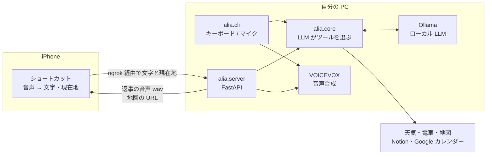

# ALIA：スマホと PC から話しかけられる AI アシスタント

[](https://github.com/8010yama/ALIA/actions/workflows/test.yml)
[](LICENSE)

iPhone か PC に話しかけると、自分の PC で動かしているローカル LLM（Ollama）が言葉の意図をくみ取り、天気・電車・地図・メモ・カレンダーの中から必要な機能を選んで実行し、VOICEVOX の声で答えます。LLM は自分の PC で動くので、会話の内容が外部の AI サービスに送られることはありません。

## できること

| 話しかける例 | ALIA がすること |
|---|---|
| 「傘いる？」「明日の大阪の天気は？」 | 天気・気温・降水確率・雨の時間帯（6日先まで。場所の指定がなければスマホの現在地） |
| 「次の電車は？」「渋谷方面の次の電車は？」 | 最寄り駅から出る次の電車まで、あと何分か（方面を言わなければ、いつもの行き先方面） |
| 「10時までに品川に着きたい」 | 乗換案内（出発・到着時刻、料金、乗り換え） |
| 「横浜まで車でナビして」 | 地図アプリで経路を開く |
| 「牛乳を買うってメモして」「レポートを TODO に追加」 | Notion のページに追記 |
| 「明日の15時にゼミを入れて」「今日の予定は？」「ゼミを13時にずらして」 | Google カレンダーに追加・読み上げ・時間変更 |
| 「明日の空いてる時間にジムを入れて」 | 予定を確認してから、空いている時間に追加（ツールを続けて使う） |

## しくみ



**LLM のツール呼び出し（function calling）**で動いています。LLM に「使える機能の一覧と、それぞれの引数」を渡すと、LLM が発話に合う機能を選び、引数を埋めて返してきます。

```
あなた > 明日の15時にゼミを入れて
  LLM → add_calendar_event(summary="ゼミ", start_time="2026-11-05 15:00")
  実行 → 「11月5日15時00分からゼミをカレンダーに追加しました。」
  LLM → 「明日の15時にゼミを入れておきました！」
```

「明日」を日付にする、どの機能を使うか決める、といった言葉の解釈はすべて LLM に任せ、Python 側は決まった形の引数を受け取って API を呼ぶだけにしています。そのため、新しい言い回しのたびに正規表現を足す必要がありません。

ツールの結果を見て、続けて別のツールを呼ぶこともできます（1回の発話で4回まで）。

```
あなた > 明日の空いてる時間にジムを入れて
  LLM → list_calendar_events(date="2026-11-05")     → 「10時00分 ゼミ」
  LLM → add_calendar_event(summary="ジム", start_time="2026-11-05 13:00")
  LLM → 「ゼミのあと、13時にジムを入れておきました！」
```

## フォルダ構成

```
alia/
  core.py        LLM に渡すツールの一覧、ツールの実行、会話の流れ
  server.py      iPhone から使うサーバー（FastAPI）
  cli.py         PC で使うコマンド版（キーボード / マイク）
  speech.py      音声合成（VOICEVOX）と音声入力（faster-whisper）
  config.py      .env の読み込み
  tools/         天気・電車・地図・Notion・Google カレンダー
scripts/
  start_alia.ps1        Ollama・VOICEVOX を起動してから ALIA を起動（Windows）
  install_autostart.ps1 PC にログインしたら ALIA のサーバーを自動で起動するよう登録
  get_refresh_token.py  Google カレンダーの初回設定
tests/           テスト（外部のサービスはすべて偽物に差し替え）
```

## セットアップ

必要なもの：Python 3.11 以上、[Ollama](https://ollama.com)、[VOICEVOX](https://voicevox.hiroshiba.jp)

```powershell
git clone https://github.com/8010yama/ALIA.git
cd ALIA
python -m venv venv
venv\Scripts\activate
pip install -r requirements.txt
ollama pull gemma4:12b          # 使うモデル（.env の OLLAMA_MODEL で変えられる）
copy .env.example .env          # .env を開いて値を書き換える
```

PC のマイクで話しかけたいときは、追加で `pip install -r requirements-voice.txt` を実行します。

### .env の設定

`.env.example` に全部の項目と説明があります。最低限、スマホから使うなら `API_KEY` と `NGROK_TOKEN` が必要です。「次の電車は？」を通勤・通学の方面で答えてほしいなら、`COMMUTE_STATION` に行き先の駅を入れます。使わない機能のキーは空のままで大丈夫です（その機能を頼んだときに「設定されていません」と答えます）。

- **Notion**：[インテグレーション](https://www.notion.so/my-integrations)を作ってシークレットを `NOTION_TOKEN` に入れ、メモ用と TODO 用のページの右上「…」→「コネクト」からそのインテグレーションをつなぎます。ページの ID は、ページの URL の末尾 32 文字です。
- **Google カレンダー**：[Google Cloud Console](https://console.cloud.google.com) で Google Calendar API を有効にし、OAuth クライアント ID（デスクトップアプリ）を作って `credentials.json` をダウンロードし、このフォルダに置きます。そのあと `python scripts/get_refresh_token.py` を実行し、表示された値を `.env` にコピーします。
- **天気の雨の情報**：[Yahoo! デベロッパーネットワーク](https://developer.yahoo.co.jp)でアプリを登録し、Client ID を `YAHOO_APP_ID` に入れます。気温は Open-Meteo（キー不要）から取ります。

## 使い方

### PC で使う

```powershell
python -m alia.cli            # キーボードで話しかける
python -m alia.cli --voice    # マイクで話しかける（Enter で録音開始、もう一度 Enter で終了）
```

返事は画面に表示され、VOICEVOX の声で読み上げられます。地図を頼むと、ブラウザで経路を開きます。

### iPhone で使う

PC でサーバーを起動します。`scripts\start_alia.ps1` を使うと、VOICEVOX も一緒に起動します。

```powershell
python -m alia.server
```

表示された `外部URL` を、iPhone の「ショートカット」アプリに設定します。

| # | アクション | 設定 |
|---|---|---|
| 1 | 現在地を取得 | |
| 2 | テキストを音声入力 | 話した言葉を文字にする |
| 3 | URL の内容を取得 | 下の表のとおり |
| 4 | URL を開く | 3 のヘッダー `X-Maps-Url` があるときだけ（地図を開く） |
| 5 | サウンドを再生 | 3 の結果（返事の音声） |

URL の内容を取得の設定：

| 項目 | 値 |
|---|---|
| URL | `https://（外部URL）/alia` |
| 方法 | POST |
| ヘッダー | `x-api-key`：`.env` の `API_KEY` と同じ文字列 |
| 本文（JSON） | `text`：2 の結果、`lat`・`lon`：1 の緯度・経度 |


**ナビ専用のショートカット**：`/navigate` に同じ形で送ると、LLM の会話を通さずにすぐ、地図の URL（`url`、Android 用は `google_url`）と目的地の天気の一言（`text`）が返ってきます。

### スマホから簡単に使うための設定

一度やっておけば、あとは iPhone で呼び出すだけになります。

1. **URL を固定する**：ngrok の無料プランでも、アカウントごとに固定の URL（dev domain）が1つもらえます。サーバーを起動したときに表示される `NGROK_DOMAIN=...` の行を `.env` に足すと、毎回同じ URL になり、ショートカットを書き換えずに済みます。
2. **PC にログインしたら自動で起動する**：`.\scripts\install_autostart.ps1` を1回実行すると、ログインのたびにサーバーが最小化したウィンドウで起動します（やめるときは `-Remove`）。PC がスリープすると届かなくなるので、電源の設定でスリープしないようにしておきます。
3. **iPhone からすぐ呼び出す**：ショートカットの名前を「アリア」にすると「Hey Siri、アリア」で起動できます。ほかに、アクションボタン（設定 →「アクションボタン」→ ショートカット）や、iPhone の背面を2回たたく（設定 → アクセシビリティ → タッチ →「背面タップ」）にも割り当てられます。

ngrok を使わずに、[Tailscale](https://tailscale.com)（無料）で iPhone と PC を同じ仮想のネットワークに入れる方法もあります。インターネットに公開しないので安全ですが、iPhone で Tailscale をつないでおく必要があります。その場合は `python -m alia.server --no-ngrok` で起動し、ショートカットの URL を `http://（PC の名前）:8000/alia` にします（Windows のファイアウォールで、8000 番への接続を許可する必要があることもあります）。

### サーバーのエンドポイント

| | 送るもの | 返るもの |
|---|---|---|
| `POST /alia`、`POST /chat_voice` | `{"text", "lat"?, "lon"?}` | 返事の wav。地図を開くときはヘッダー `X-Maps-Url` |
| `POST /chat_text` | `{"text", "lat"?, "lon"?}` | `{"text": 返事}`（音声なし。動作確認用） |
| `POST /navigate` | `{"text", "lat", "lon"}` | `{"url", "google_url", "text"}` |
| `GET /health` | | `{"status": "ok"}` |

`/health` 以外は、ヘッダー `x-api-key` が `.env` の `API_KEY` と一致しないと 401 を返します。

## テスト

```powershell
pip install -r requirements-dev.txt
python -m pytest
```

Ollama・VOICEVOX・各サービスの API はすべて偽物に差し替えているので、`.env` もネットもなしで動きます。push のたびに GitHub Actions で、Python 3.11〜3.14 のテストを走らせています。

## これまでの改良

1. **最初の版（6月）**：発話に「電車」「メモして」などのキーワードが含まれるかで機能を振り分け、日時や駅名を正規表現で読み取っていました。言い回しが少し変わるだけで読み取りに失敗し、テストを書いたところ「来週の金曜」が今週の金曜になる、予定名に「10時に」が残る、などのバグが見つかりました。
2. **LLM のツール呼び出しに作り直し（8月）**：機能の選択と引数の読み取りを LLM に任せる形に変え、上のような読み取りのバグを、正規表現ごとなくしました。PC 用とスマホ用で、同じ中心の処理（`alia/core.py`）を使うようにしました。
3. **整理とテスト（11月）**：フォルダを分け、テストと CI を追加しました。その中で、サーバーを日をまたいで動かすと LLM に伝える「今日の日付」が古いままになる問題や、スマホの現在地が天気に使われていなかった問題を見つけて直しました。
4. **できることを増やす（11月）**：明日以降の天気、方面を指定した次の電車、ツールを続けて使う（予定を確認してから追加する、など）に対応しました。スマホから使う手間を減らすため、URL の固定と PC 起動時の自動起動もできるようにしました。

## ライセンス

[MIT](LICENSE)
